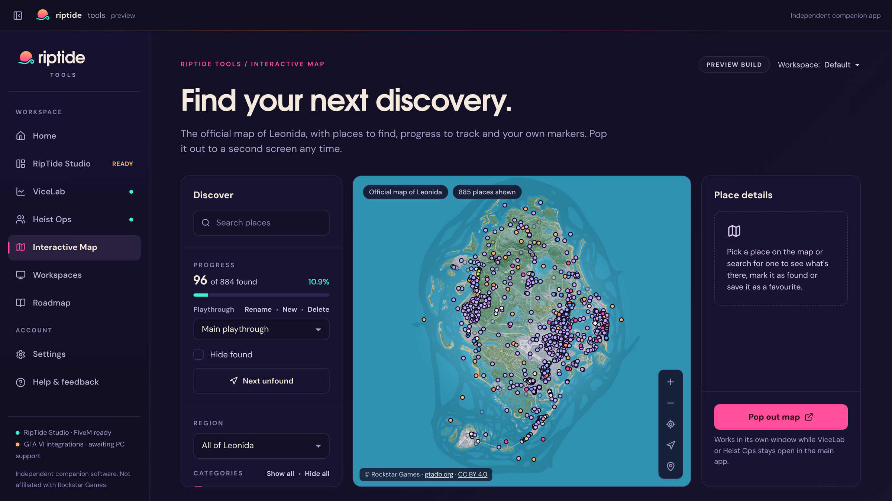
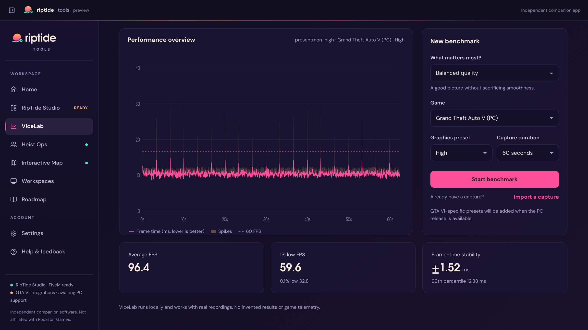
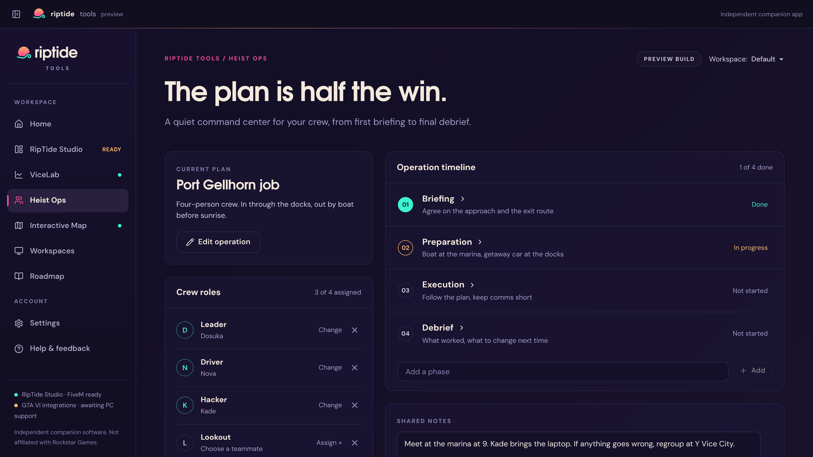
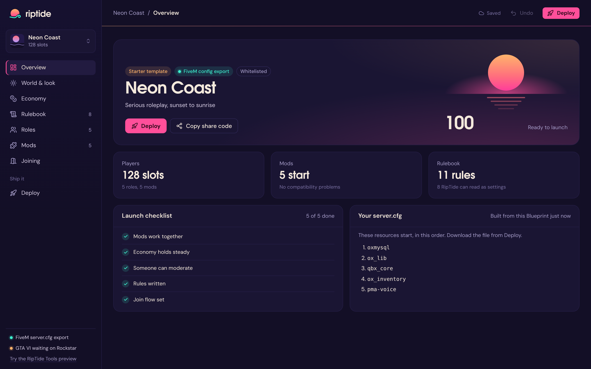
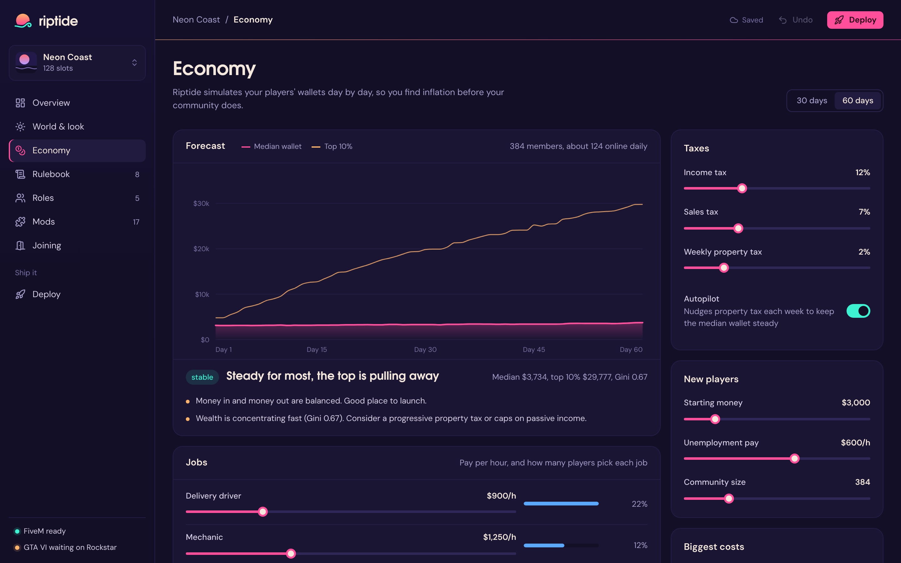
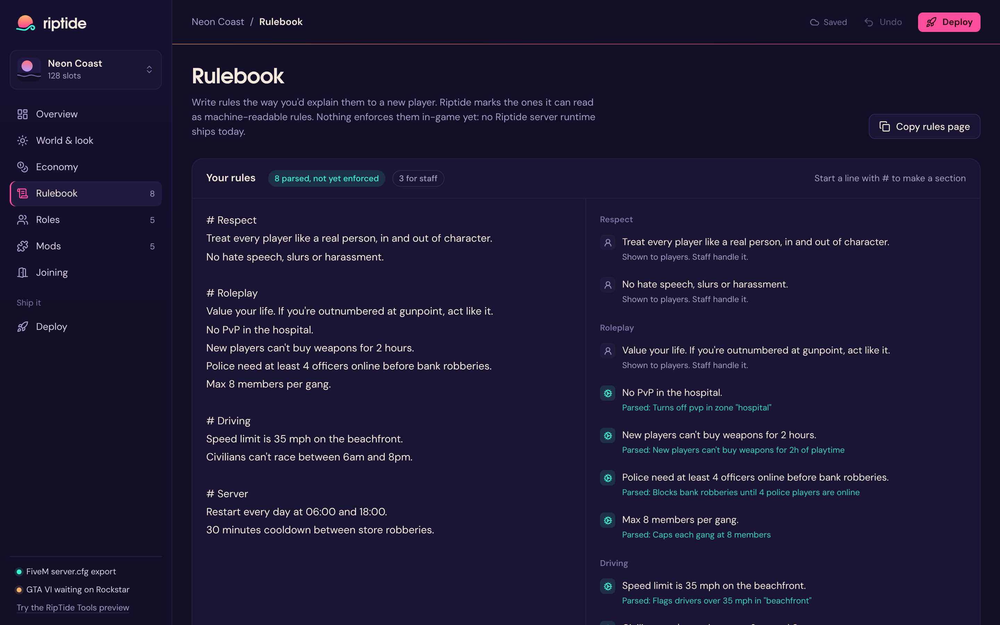
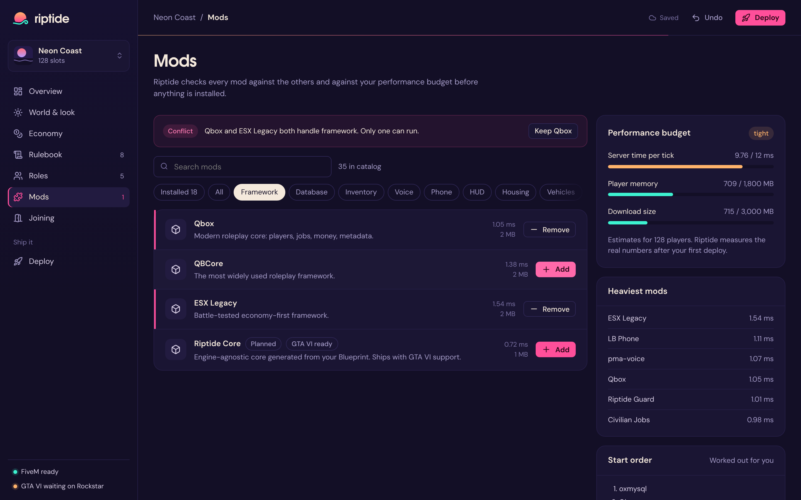
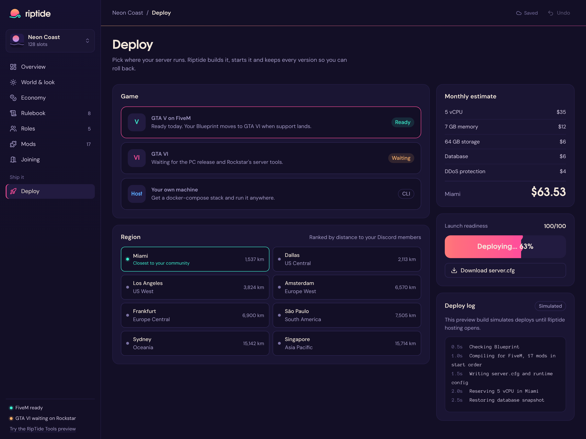
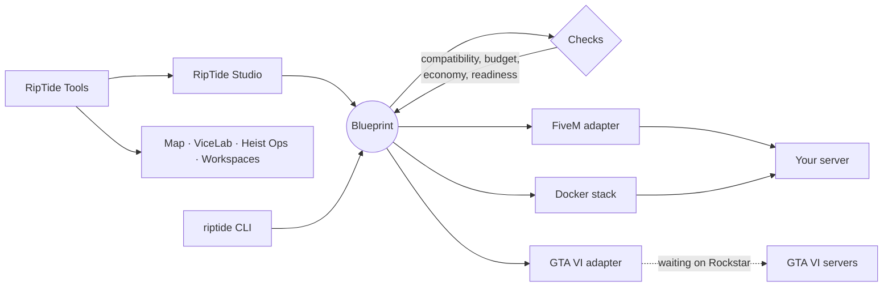

<p align="center">
  <picture>
    <source media="(prefers-color-scheme: dark)" srcset="brand/logo-animated-dark.svg">
    
  </picture>
</p>

<p align="center">
  <b>Every tool for your GTA life. One app.</b><br>
  The official map of Leonida, real benchmarks, crew plans, a no-code server studio and multi-monitor workspaces. Built for GTA VI on PC.
</p>

<p align="center">
  
  
  
  
  
</p>

<p align="center">
  <a href="https://dosukasol.github.io/RipTide/app/?shell=tools"><b>Open RipTide Tools in your browser</b></a>
  &nbsp;·&nbsp;
  <a href="https://dosukasol.github.io/RipTide/"><b>Website</b></a>
  &nbsp;·&nbsp;
  <a href="https://dosukasol.github.io/RipTide/#trailer">Trailer</a>
  &nbsp;·&nbsp;
  <a href="https://discord.gg/N88znNpSgC">Discord</a>
</p>

---

> [!IMPORTANT]
> **We're building ahead of GTA VI on PC.** GTA VI is out on consoles, and RipTide's Interactive Map already uses the official map of Leonida. Rockstar hasn't announced the PC release, GTA VI Online, or how community servers will work, so everything that needs the game on PC waits for that.
>
> Expect **lots of updates and some big changes** as we learn more about GTA VI on PC and GTA VI Online. Until then, RipTide Studio builds GTA V servers on FiveM, and every Blueprint you design is made to move to GTA VI when support lands.

<p align="center">
  
</p>

## What is RipTide?

RipTide is one app for your whole GTA setup. Five tools live side by side, stay running while you switch between them, and pop out onto a second monitor when you want them there. Everything runs on your PC: no account, nothing uploaded, and nothing that touches the game.

| Tool | What it does |
| --- | --- |
| **Interactive Map** | The official map of Leonida with 884 places to find in nine categories. Search, region filters, found tracking across up to eight playthroughs, favourites, your own markers and a second-screen pop-out. |
| **ViceLab** | Real frame times from PresentMon, CapFrameX, MangoHud, OCAT and FrameView: average FPS, 1% and 0.1% lows, stability. Screenshot compare and settings picked from your own runs. |
| **Heist Ops** | Plan the job with your crew: roles, phases, checklists and shared notes. Share a plan as a file. |
| **RipTide Studio** | Design a roleplay or community server without code, check it fits together, and build it for FiveM. More below. |
| **Workspaces** | Detach tools into their own windows. They remember where they were and come back on screen if a monitor is unplugged. |

<table>
  <tr>
    <td width="50%"><br><sub><b>Interactive Map.</b> Real places, real details, marked found in one click.</sub></td>
    <td width="50%"><br><sub><b>ViceLab.</b> 1% lows from your own captures, not guesses.</sub></td>
  </tr>
  <tr>
    <td><br><sub><b>Heist Ops.</b> Roles, phases and checklists for your crew.</sub></td>
    <td><br><sub><b>Home.</b> Every tool, and what's running.</sub></td>
  </tr>
</table>

What works today, what's a demonstration and what waits for GTA VI on PC: **[docs/TOOLS.md](docs/TOOLS.md)**.

## Why RipTide

- **All in one app.** Five tools, one window, one workspace.
- **Two screens, one setup.** Pop any tool out and it remembers where it was.
- **Stays on your PC.** No account needed, nothing is uploaded.
- **Never touches the game.** No memory reads, no injection, no bots. ViceLab only reads files your capture tool saved.
- **Honest data.** Numbers come from your own runs, map data is credited, nothing is made up.
- **Ready for GTA VI on PC.** Built to support it the day Rockstar's PC tools land.

## RipTide Studio

Running a good server today means juggling a dozen config files, a Discord bot, a hosting panel, a spreadsheet for the economy and a rules doc nobody reads. Studio puts all of it in one place.

You describe your server once as a **Blueprint**: rules, roles, economy, mods, visuals, who can join. RipTide checks that it all fits together, shows you what will happen before players arrive, and builds it for your server. No scripting needed, and nothing hidden if you do know how.

<p align="center">
  
</p>

### Things nobody else does

These ideas are new for game servers, and most of them already work in the preview.

| | |
| --- | --- |
| **Economy forecast** | Simulates 60 days of your players' wallets before launch, so you see inflation and broke newcomers coming. Autopilot can nudge taxes to keep things steady. |
| **Plain-English rulebook** | Write *"Police need at least 4 officers online before bank robberies."* RipTide enforces the rules it understands, leaves the rest to staff, and publishes one rules page plus a Discord post that never drift apart. |
| **Mod compatibility check** | Spots duplicate systems, missing dependencies and wrong-game mods *before* you install, with one-click fixes and a worked-out start order. |
| **Performance budget** | Server time, player memory and first-join download size, estimated for your player count while you browse mods. |
| **Launch readiness** | A single score, drawn as a sun rising over the water. At 100 it clears the horizon. |
| **Preview servers** | Branch your server, let staff test a change, then merge it. Coming with RipTide hosting. |
| **Share codes** | Turn a whole server into a code that others can remix. |
| **Engine-agnostic Blueprints** | The same Blueprint builds for FiveM today and GTA VI tomorrow. Only the adapter changes. |
| **Region by community** | Picks the hosting region closest to where your Discord members actually are. |

<table>
  <tr>
    <td width="50%"><br><sub><b>Economy.</b> Wallet forecast, taxes, jobs and autopilot.</sub></td>
    <td width="50%"><br><sub><b>Rulebook.</b> Write it in English, see what's enforced.</sub></td>
  </tr>
  <tr>
    <td><br><sub><b>Mods.</b> Conflicts caught before install, with a fix.</sub></td>
    <td><br><sub><b>Roles.</b> Who can do what, inheritance at a glance.</sub></td>
  </tr>
  <tr>
    <td><br><sub><b>World & look.</b> Time, weather, streets and a live visual preview.</sub></td>
    <td><br><sub><b>Deploy.</b> Pick a game and region. Hosted deploys are simulated until hosting opens.</sub></td>
  </tr>
</table>

### What you can plug in

Frameworks, inventories, voice, phones, HUDs, housing, garages, jobs, police and EMS tools, interiors, clothing, anti-cheat, admin panels, Discord, streaming tools, stores, analytics, visual presets and accessibility. The full map, with what works today and what's waiting on GTA VI, lives in **[docs/INTEGRATIONS.md](docs/INTEGRATIONS.md)**.

## Try it

The quickest way: **[open RipTide Tools in your browser](https://dosukasol.github.io/RipTide/app/?shell=tools)**. Nothing to install, and everything stays on your device.

To run it yourself, you'll need Node 20 or newer.

```bash
npm install
npm run build
npm test
npm run e2e   # browser tests, needs Playwright

# Open the app at http://127.0.0.1:5173 (add ?shell=tools for RipTide Tools)
npm run dev

# Or build the website and the app together at http://127.0.0.1:4173
npm run site

# Or use the CLI
npm run riptide -- check examples/neon-coast.riptide.json
npm run riptide -- forecast examples/neon-coast.riptide.json
npm run riptide -- build examples/neon-coast.riptide.json --target fivem --out dist/neon-coast
```

The app runs entirely on your machine or in your browser. It doesn't send data anywhere, and hosted deploys are simulated until RipTide hosting opens.

## How it's built



- **`packages/core`**: the Studio engine. Blueprint schema, catalog, compatibility, budget, economy simulation, rulebook compiler, readiness, hosting estimates, share codes, diffs and adapters. No UI, fully tested.
- **`packages/tools`**: logic for the other tools: frame-time parsing and stats, heist plans, map places and packs, window layout recovery, validated storage. Fully tested.
- **`packages/cli`**: `riptide` on the command line, for people who like files and git.
- **`apps/studio`**: the app itself, with RipTide Tools and Studio.
- **`site`**: the website, published to GitHub Pages with the app at `/app/`.

More detail in [docs/ARCHITECTURE.md](docs/ARCHITECTURE.md).

## Roadmap

- [x] Blueprint format, compatibility check, performance budget
- [x] Economy forecast with autopilot
- [x] Plain-English rulebook with Discord and web output
- [x] FiveM adapter and docker stack
- [x] Studio design and startup animation
- [x] RipTide Tools preview: ViceLab, Heist Ops, Interactive Map, Workspaces
- [x] Official map of Leonida with places, found tracking and playthroughs
- [x] Website with the app in your browser
- [ ] Live crew rooms for Heist Ops
- [ ] Discord bot: role sync, applications, rules post
- [ ] RipTide hosting with preview servers and rollbacks
- [ ] Desktop app
- [ ] **GTA VI on PC: benchmarks, presets and the server adapter, the moment Rockstar's PC tools exist**

The longer version is in [docs/ROADMAP.md](docs/ROADMAP.md).

## FAQ

**Is it free?** Yes. The preview is free to use, in your browser or on your own machine.

**Is this made by Rockstar?** No. RipTide is an independent project and isn't affiliated with Rockstar Games, Take-Two or Cfx.re.

**Does it work with GTA VI right now?** The Interactive Map does: it uses the official map of Leonida. Everything that needs the game on PC, like benchmarks and servers, waits for GTA VI on PC, which Rockstar hasn't announced yet.

**Is it safe to use with my game?** RipTide never reads game memory, injects anything or automates gameplay. ViceLab only reads capture files your own tools saved.

**Will RipTide follow Rockstar's rules for community servers?** Yes. We follow the platform's terms, including its rules on monetization, and refuse leaked or stolen assets.

**Is it open source?** Not right now. The code is public so you can see what we're building, but all rights are reserved. That may change later.

## License

Copyright © 2026 Dosuka. All rights reserved. See [LICENSE](LICENSE).

The Interactive Map isn't ours: the map of Leonida is © Rockstar Games, and the place data comes from [gtadb.org](https://map.gtadb.org) and contributors under [CC BY 4.0](https://creativecommons.org/licenses/by/4.0/). Details in [THIRD_PARTY_NOTICES.md](THIRD_PARTY_NOTICES.md).

Grand Theft Auto, GTA V and GTA VI are trademarks of their respective owners and are mentioned only to describe compatibility.

<p align="center"><sub>Made by <a href="https://github.com/DosukaSOL">DosukaSOL</a>, creator of PushFPS. Built for the people who keep the city running after midnight.</sub></p>
