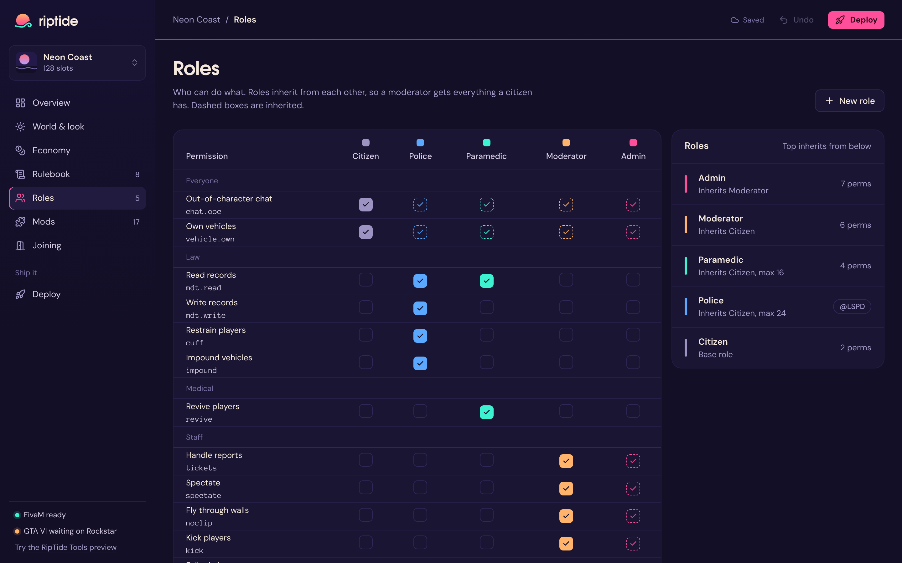
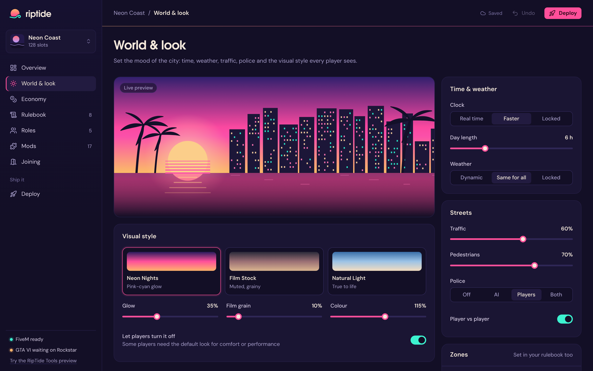
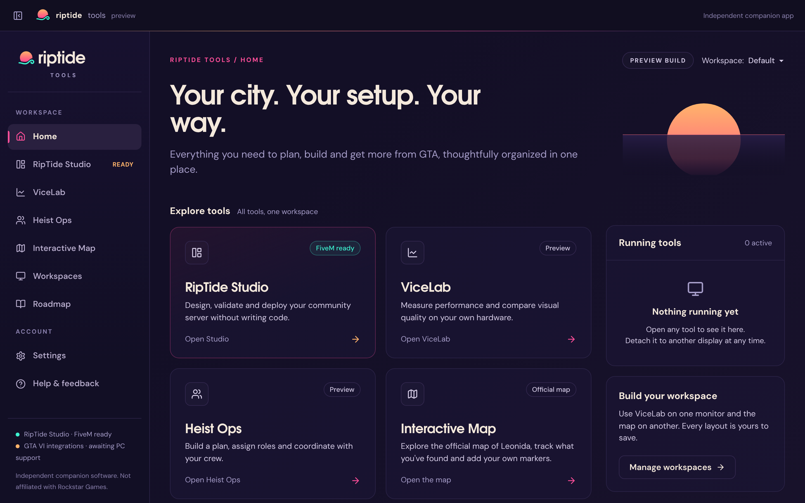
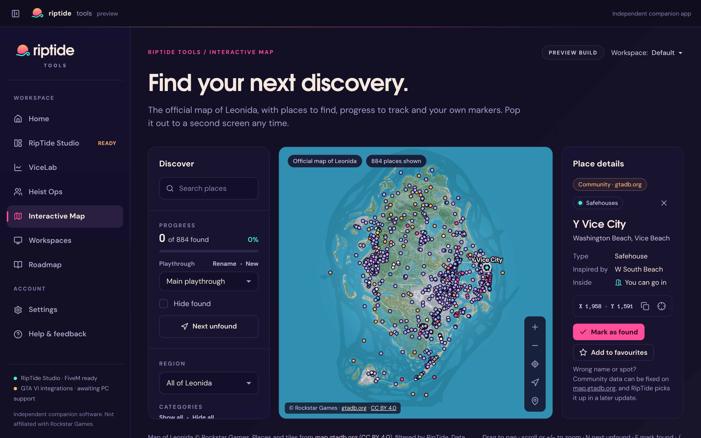
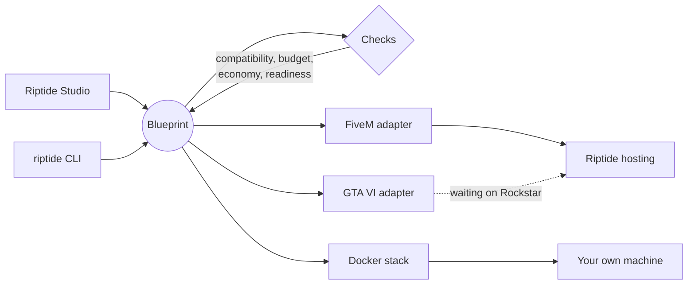

<p align="center">
  <picture>
    <source media="(prefers-color-scheme: dark)" srcset="brand/logo-animated-dark.svg">
    
  </picture>
</p>

<p align="center">
  <b>Design your server once. Deploy it anywhere.</b><br>
  The no-code server studio for roleplay and community servers, getting ready for GTA VI on PC.
</p>

<p align="center">
  
  
  
  
</p>

---

> [!IMPORTANT]
> **We're building ahead of GTA VI on PC.** GTA VI is out on consoles, but Rockstar hasn't announced the PC release date, GTA VI Online, or how community servers will work. Riptide is us getting everything ready in advance so server owners can launch on day one.
>
> Expect **lots of updates and some big changes** as we learn more about GTA VI Online's framework, engine and server setup. Until then, Riptide builds GTA V servers on FiveM, and every Blueprint you design is made to move to GTA VI when support lands.

<p align="center">
  
</p>

## What is Riptide?

Running a good server today means juggling a dozen config files, a Discord bot, a hosting panel, a spreadsheet for the economy and a rules doc nobody reads. Riptide puts all of it in one place.

You describe your server once as a **Blueprint**: rules, roles, economy, mods, visuals, who can join. Riptide checks that it all fits together, shows you what will happen before players arrive, and deploys it with one click. No scripting needed, and nothing hidden if you do know how.

## Things nobody else does

These ideas are new for game servers, and most of them already work in the preview.

| | |
| --- | --- |
| **Economy forecast** | Simulates 60 days of your players' wallets before launch, so you see inflation and broke newcomers coming. Autopilot can nudge taxes to keep things steady. |
| **Plain-English rulebook** | Write *"Police need at least 4 officers online before bank robberies."* Riptide enforces the rules it understands, leaves the rest to staff, and publishes one rules page plus a Discord post that never drift apart. |
| **Mod compatibility check** | Spots duplicate systems, missing dependencies and wrong-game mods *before* you install, with one-click fixes and a worked-out start order. |
| **Performance budget** | Server time, player memory and first-join download size, estimated for your player count while you browse mods. |
| **Launch readiness** | A single score, drawn as a sun rising over the water. At 100 it clears the horizon. |
| **Preview servers** | Branch your server, let staff test a change, then merge it. Deploy previews, but for game servers. |
| **Share codes** | Turn a whole server into a code that others can remix. |
| **Engine-agnostic Blueprints** | The same Blueprint builds for FiveM today and GTA VI tomorrow. Only the adapter changes. |
| **Region by community** | Picks the hosting region closest to where your Discord members actually are. |

## A closer look

<table>
  <tr>
    <td width="50%"><br><sub><b>Economy.</b> Wallet forecast, taxes, jobs and autopilot.</sub></td>
    <td width="50%"><br><sub><b>Rulebook.</b> Write it in English, see what's enforced.</sub></td>
  </tr>
  <tr>
    <td><br><sub><b>Mods.</b> Conflicts caught before install, with a fix.</sub></td>
    <td><br><sub><b>Roles.</b> Who can do what, inheritance at a glance.</sub></td>
  </tr>
  <tr>
    <td><br><sub><b>World & look.</b> Time, weather, streets and a live visual preview.</sub></td>
    <td><br><sub><b>Deploy.</b> Pick a game and region, watch it go live.</sub></td>
  </tr>
</table>

## RipTide Tools (preview)

Studio is getting company. **RipTide Tools** puts Studio and four companion tools in one app: **ViceLab** for frame-time benchmarks and image compare, **Heist Ops** for crew plans, an **Interactive Map** you can pop out to a second monitor, and **Workspaces** to arrange it all across your displays. Open tools stay running while you switch between them.

It's behind a flag while we finish it. Add `?shell=tools` to the Studio address to try it, or `?shell=classic` to go back. The map is Rockstar's official map of Leonida with about 900 community-mapped places to find and tick off. Anything that needs GTA VI on PC is clearly marked and switched off until it's out. There's no made-up data.

<table>
  <tr>
    <td width="50%"><br><sub><b>Home.</b> Every tool, and what's running.</sub></td>
    <td width="50%"><br><sub><b>ViceLab.</b> Real frame times from your own captures.</sub></td>
  </tr>
  <tr>
    <td><br><sub><b>Heist Ops.</b> Roles, phases and checklists for your crew.</sub></td>
    <td><br><sub><b>Interactive Map.</b> The official map, places to find and a second-screen pop-out.</sub></td>
  </tr>
</table>

What's working, what's a demonstration, and what waits for GTA VI: **[docs/TOOLS.md](docs/TOOLS.md)**.

## What you can plug in

Frameworks, inventories, voice, phones, HUDs, housing, garages, jobs, police and EMS tools, interiors, clothing, anti-cheat, admin panels, Discord, streaming tools, stores, analytics, visual presets and accessibility. The full map, with what works today and what's waiting on GTA VI, lives in **[docs/INTEGRATIONS.md](docs/INTEGRATIONS.md)**.

## How it works



- **`packages/core`**: the engine. Blueprint schema, catalog, compatibility, budget, economy simulation, rulebook compiler, readiness, hosting estimates, share codes, diffs and adapters. No UI, fully tested.
- **`packages/cli`**: `riptide` on the command line, for people who like files and git.
- **`apps/studio`**: the visual editor in the screenshots.

More detail in [docs/ARCHITECTURE.md](docs/ARCHITECTURE.md).

## Try the preview

You'll need Node 20 or newer.

```bash
npm install
npm run build
npm test
npm run e2e   # browser tests, needs Playwright

# Open the Studio at http://127.0.0.1:5173
npm run dev

# Or use the CLI
npm run riptide -- check examples/neon-coast.riptide.json
npm run riptide -- forecast examples/neon-coast.riptide.json
npm run riptide -- build examples/neon-coast.riptide.json --target fivem --out dist/neon-coast
```

The preview runs entirely on your machine. It doesn't send data anywhere, and hosted deploys are simulated until Riptide hosting opens.

## Roadmap

- [x] Blueprint format, compatibility check, performance budget
- [x] Economy forecast with autopilot
- [x] Plain-English rulebook with Discord and web output
- [x] FiveM adapter and docker stack
- [x] Studio design and startup animation
- [x] RipTide Tools preview: ViceLab, Heist Ops, Interactive Map, Workspaces
- [ ] Discord bot: role sync, applications, rules post
- [ ] Riptide hosting with preview servers and rollbacks
- [ ] Live economy and performance view after launch
- [ ] **GTA VI adapter, the moment Rockstar's PC tools exist**

The longer version is in [docs/ROADMAP.md](docs/ROADMAP.md).

## FAQ

**Is this made by Rockstar?** No. Riptide is an independent project and isn't affiliated with Rockstar Games, Take-Two or Cfx.re.

**Does it work with GTA VI right now?** Not yet, because nobody's does: there's no PC version or server tooling to target. Design your server now and it moves over when support lands.

**Will Riptide follow Rockstar's rules for community servers?** Yes. We follow the platform's terms, including its rules on monetization, and refuse leaked or stolen assets.

**Is it open source?** Not right now. The code is public so you can see what we're building, but all rights are reserved. That may change later.

## License

Copyright © 2026 Dosuka. All rights reserved. See [LICENSE](LICENSE).

The Interactive Map isn't ours: the map of Leonida is © Rockstar Games, and the place data comes from [gtadb.org](https://map.gtadb.org) and contributors under [CC BY 4.0](https://creativecommons.org/licenses/by/4.0/). Details in [THIRD_PARTY_NOTICES.md](THIRD_PARTY_NOTICES.md).

Grand Theft Auto, GTA V and GTA VI are trademarks of their respective owners and are mentioned only to describe compatibility.

<p align="center"><sub>Built for the people who keep the city running after midnight.</sub></p>
